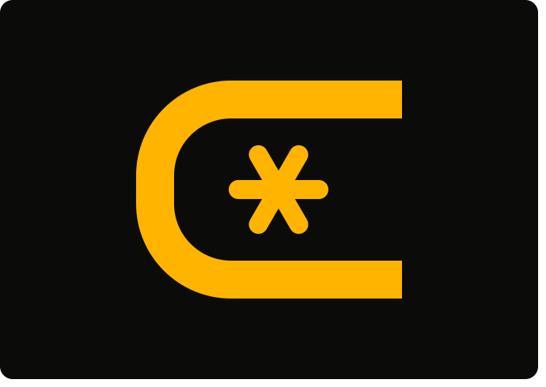

# Chanafiqri (ჩანაფიქრი): AI ვიდეო & ფოტო გენერაციის პლატფორმა

**დოკუმენტაცია:**

* [Product Backlog](./docs/backlog.md)
* [GitHub Projects დაფა](https://github.com/users/duda-el/projects/1)

---

  

## პროექტის აღწერა

**Chanafiqri** არის ინოვაციური AI ვიზუალური პლატფორმა, რომელიც მომხმარებლებს აძლევს საშუალებას მყისიერად დააგენერირონ, გარდაქმნან და დაამუშაონ მაღალი ხარისხის ფოტო და ვიდეო კონტენტი. ვებ-საიტი აგვარებს რთული ვიდეო მონტაჟისა და ძვირადღირებული გადაღებების პრობლემას ხელოვნური ინტელექტის მრავალფუნქციური ინსტრუმენტების ერთ სივრცეში გაერთიანებით - ტექსტური მითითებების (Prompts), საწყისი მედია ფაილების, მზა ტრენდული შაბლონებისა და AI ეფექტების გამოყენებით. პლატფორმა მომხმარებელს სთავაზობს მოქნილ გარემოს ნებისმიერი ტიპის ვიზუალური ამოცანისთვის. პლატფორმაზე მოქმედებს კრედიტების საბანკო სისტემა და გამომწერის პაკეტები (Subscriptions), რაც მომხმარებელს აძლევს წვდომას გენერაციის რესურსებზე.

## Stakeholder-ები

**მომხმარებელი (End User).** პლატფორმის ძირითადი მომხმარებელი. სურს მზა შაბლონებისა და AI გენერაციის ინსტრუმენტების გამოყენებით მყისიერად მიიღოს მაღალი ხარისხის ვიდეო და ფოტო კონტენტი. ვეტო არ აქვს, მაგრამ სისტემის მთავარი მომხმარებელია.

**სისტემის ადმინისტრატორი (System Admin).** აკონტროლებს მომხმარებელთა ანგარიშებს, აწესებს GPU სერვერების დაყოვნებისა და გენერაციის დღიურ ლიმიტებს (Quotas) და მართავს შაბლონების ბიბლიოთეკას. აქვს ვეტოს უფლება მომხმარებლის დაბლოკვაზე ან ლიმიტის შეზღუდვაზე.

**პროდუქტის მფლობელი / დეველოპერი (Product Owner).** იხდის GPU Cloud სერვერებისა და AI მოდელების (API) ხარჯებს. აქვს სრული ვეტოს უფლება პროექტის ფუნქციონალზე და აინტერესებს სტაბილური MVP-ის დროული გაშვება.

**გადახდის პროვაიდერი (Flitt).** უზრუნველყოფს კრედიტების შეძენისა და გამომწერის პაკეტების უსაფრთხო ფინანსურ ტრანზაქციებს პლატფორმაზე. აქვს ვეტოს უფლება საეჭვო ან არასანქცირებულ გადახდებზე და ითხოვს უსაფრთხოების სტანდარტების დაცვას.

**AI API პროვაიდერები (Higgsfield / OpenAI / Google Gemini / Claude).** გარე ტექნოლოგიური პარტნიორები, რომლებიც უზრუნველყოფენ AI ვიდეო, ფოტო და ტექსტურ გენერაციას. მათ აქვთ ვეტოს უფლება მომსახურების პირობების დარღვევისას (მაგ. არასათანადო კონტენტის გენერაცია) და აწესებენ API მოთხოვნების სიჩქარისა და ფასწარმოქმნის ლიმიტებს.
