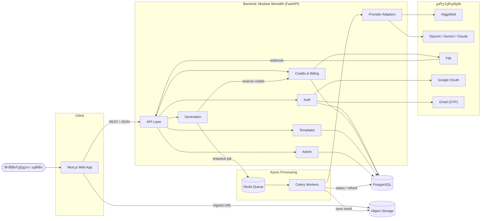
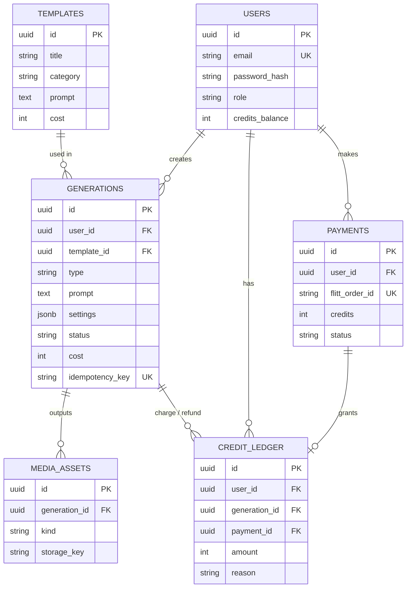

# Product Architecture: Chanafiqri

[← მთავარ გვერდზე (README.md)](../README.md) · [Product Backlog](./backlog.md)

> ტექნოლოგიური არჩევანი ემყარება backlog-ში დაფიქსირებულ გადაწყვეტილებებსა და NFR-ებს (Celery/Redis, Flitt, Google OAuth, Higgsfield, LLM, k6, Lighthouse).

---

## 1. არქიტექტურული სტილი

**არჩეული სტილი: Modular Monolith + Asynchronous Job Queue**

ერთი deployable Backend, შიგნით გამიჯნული მოდულებით (Auth, Generation, Credits, Templates, Admin). AI გენერაცია გატანილია ცალკე Celery Worker-ებში.

**არგუმენტები:**

1. **MVP-ის ზომა და გუნდი.** MVP მცირეა (24 SP), ამიტომ Microservices-ის სირთულე (service discovery, ცალკე CI/CD, distributed tracing) ზედმეტია. Monolith = ერთი repo, ერთი deploy, მარტივი debugging.
2. **კრედიტების სიზუსტე (NFR-05, ცდომილება 0%).** კრედიტის ჩამოჭრა, refund და შევსება ერთ PostgreSQL ტრანზაქციაში ხდება (ACID). Microservices-ში ეს Saga-ს მოითხოვდა, ანუ რისკი იმ ადგილას გაიზრდებოდა, სადაც შეცდომა დაუშვებელია.
3. **გრძელი ამოცანები არ ბლოკავს API-ს (NFR-02, NFR-03).** API მხოლოდ ქმნის Job-ს და 2 წამში პასუხობს, მძიმე გენერაციას Worker-ები ასრულებენ და დამოუკიდებლად სკალირდებიან.

**უარყოფილი:** Microservices (ზედმეტი სირთულე MVP-სთვის), Serverless (გრძელი ამოცანები და vendor lock-in).

---

## 2. კომპონენტების დიაგრამა

### დიაგრამის აღწერა

| კომპონენტი | როლი |
|---|---|
| **Next.js Web App** | მომხმარებლის ინტერფეისი. API-სთან მუშაობს REST/JSON-ით, ხოლო მედია ფაილებს Signed URL-ით პირდაპირ Object Storage-იდან ტვირთავს და ჩამოტვირთავს |
| **API Layer** | Backend-ის ერთადერთი შესასვლელი: მოთხოვნების ვალიდაცია, rate limit და გადამისამართება შესაბამის მოდულზე |
| **Auth** | რეგისტრაცია, ლოგინი, OTP (Email სერვისით) და Google OAuth, JWT-ის გაცემა |
| **Generation** | გენერაციის პარამეტრების დამუშავება, ფასის გამოთვლა, კრედიტის დაჯავშნა (Credits-ის მეშვეობით) და Job-ის რიგში ჩასმა |
| **Credits & Billing** | კრედიტების ledger, ჩამოჭრა და refund; გადახდის შექმნა Flitt-ში და webhook-ით დადასტურება |
| **Templates** | შაბლონების ბიბლიოთეკა და კატეგორიები |
| **Admin** | მომხმარებლების მართვა, პროვაიდერის ლიმიტები და ანალიტიკა |
| **Provider Adapters** | ერთიანი ინტერფეისი გარე AI სერვისებთან სამუშაოდ (Higgsfield, OpenAI, Gemini, Claude) |
| **Redis Queue** | გენერაციის Job-ების რიგი და დროებითი მონაცემები (rate-limit მრიცხველები) |
| **Celery Workers** | იღებენ Job-ს რიგიდან, მიმართავენ AI პროვაიდერს, შედეგს ინახავენ Storage-ში და ანახლებენ სტატუსს (წარუმატებლობისას აბრუნებენ კრედიტს) |
| **PostgreSQL** | მთავარი მონაცემთა ბაზა: მომხმარებლები, გენერაციები, ledger, გადახდები |
| **Object Storage** | გენერირებული და ატვირთული მედია ფაილები |

**მონაცემთა ნაკადი მოკლედ:** მომხმარებელი აგზავნის გენერაციის მოთხოვნას → API ამოწმებს და Generation მოდული Credits-ის მეშვეობით ჯავშნის კრედიტს ბაზაში → Job ხვდება Redis რიგში და მომხმარებელი იღებს სწრაფ პასუხს → Worker იღებს Job-ს და მიმართავს AI პროვაიდერს Adapter-ით → შედეგი ინახება Storage-ში, სტატუსი ახლდება ბაზაში → Frontend სტატუსს პერიოდულად ამოწმებს და შედეგს აჩვენებს.

---

## 3. Design Pattern-ები

### Backend

| Pattern | სად გამოიყენება | რატომ |
|---|---|---|
| **Strategy + Adapter** | `AIProvider` ინტერფეისი და `HiggsfieldAdapter`, `OpenAIAdapter`, `GeminiAdapter`, `ClaudeAdapter` | პროვაიდერის შეცვლა ბიზნეს ლოგიკის შეცვლის გარეშე |
| **Repository** | `UserRepository`, `GenerationRepository`, `LedgerRepository` | ბიზნეს ლოგიკა გამიჯნულია SQL-სგან, ტესტირება mock-ით |
| **Service Layer + Unit of Work** | `CreditService.reserve()` / `refund()` | კრედიტის ჩამოჭრა და Job-ის შექმნა ერთ ატომურ ტრანზაქციაში |
| **State Machine** | `QUEUED → PROCESSING → COMPLETED / FAILED` | დაუშვებელი გადასვლების აკრძალვა |

### Frontend

| Pattern | სად გამოიყენება | რატომ |
|---|---|---|
| **Custom Hooks + TanStack Query** | `useGeneration(id)` (polling), `useCredits()` | API ლოგიკა გამოყოფილია UI-გან, მზა caching/polling |
| **Container / Presentational** | `GenerationPage` (data) და `SettingsPanel`, `ResultCard` (UI) | კომპონენტების ხელახალი გამოყენება |
| **Context Provider** | `AuthProvider` (user, token, credits) | გლობალური state Prop Drilling-ის გარეშე |

---

## 4. API (5 Endpoint)

Base URL: `/api/v1` · Auth: `Authorization: Bearer <JWT>` (გარდა `/auth/*` და webhook-ისა)

| # | Endpoint | დანიშნულება | Request | Response |
|---|---|---|---|---|
| 1 | `POST /auth/register` | რეგისტრაცია + OTP | `{ email, password }` | `201` · `422` |
| 2 | `POST /generations` | გენერაციის დაწყება, კრედიტის დაჯავშნა | Header: `Idempotency-Key`. Body: `{ type, prompt, template_id?, settings }` | `202 { id, status, cost }` · `402` კრედიტი არ ყოფნის |
| 3 | `GET /generations/{id}` | Job-ის სტატუსი და შედეგი | - | `200 { id, status, result_url? }` · `404` |
| 4 | `GET /templates?category=&page=` | შაბლონების ბიბლიოთეკა | Query params | `200 { items, next_page }` |
| 5 | `POST /webhooks/flitt` | გადახდის დადასტურება, კრედიტების ჩარიცხვა | Flitt callback + ხელმოწერა | `200` · `400` არასწორი ხელმოწერა |

---

## 5. ბაზა: SQL (PostgreSQL)

**რატომ SQL:** კრედიტები და გადახდები მოითხოვს ACID ტრანზაქციებს (NFR-05), მონაცემები რელაციურია, ხოლო ცვალებადი პარამეტრებისთვის გვაქვს `JSONB`. Redis გამოიყენება მხოლოდ queue-სა და დროებითი მონაცემებისთვის.

**პრინციპები:**
- `credit_ledger` არის append-only, ბალანსი = ჩანაწერების ჯამი, `users.credits_balance` კი სწრაფი კეშია.
- ჩამოჭრისას `SELECT ... FOR UPDATE` იცავს პარალელური მოთხოვნებისგან.
- `UNIQUE(idempotency_key)` და `UNIQUE(flitt_order_id)` იცავს დუბლირებისგან.

---

## 6. ტექნოლოგიური სტეკი

| ფენა | ტექნოლოგია |
|---|---|
| Frontend | Next.js (React) + TypeScript + Tailwind CSS + TanStack Query |
| Backend | Python + FastAPI + Pydantic |
| Async | Celery + Redis |
| Database | PostgreSQL (SQLAlchemy + Alembic) |
| Storage | S3-compatible (Cloudflare R2 / AWS S3) + Signed URLs |
| Auth / Payments | JWT + Google OAuth 2.0 / Flitt |
| AI | Higgsfield (ვიდეო/ფოტო), OpenAI / Gemini / Claude (Prompt Enhancer) |
| DevOps / Testing | Docker, GitHub Actions, k6, Lighthouse, Sentry |

### რისკები

| # | რისკი | შემცირება |
|---|---|---|
| 1 | **AI პროვაიდერზე დამოკიდებულება:** ფასის ზრდა, rate limit ან გათიშვა აჩერებს ძირითად ფუნქციას | Adapter + Strategy (სწრაფი გადართვა), Redis throttling, დღიური ლიმიტები |
| 2 | **კრედიტებისა და გადახდების არასწორი აღრიცხვა:** ორმაგი ჩამოჭრა, განმეორებული webhook | Append-only ledger, `FOR UPDATE`, Idempotency Key, webhook-ის ხელმოწერა, ავტომატური refund |
| 3 | **Face Swap-ის ბოროტად გამოყენება და კონფიდენციალურობა** (deepfake, სახის ფოტოები) | Terms of Use + თანხმობა, მოდერაცია გაგზავნამდე, მომხმარებლის დაბლოკვა, ფოტოების TTL |
