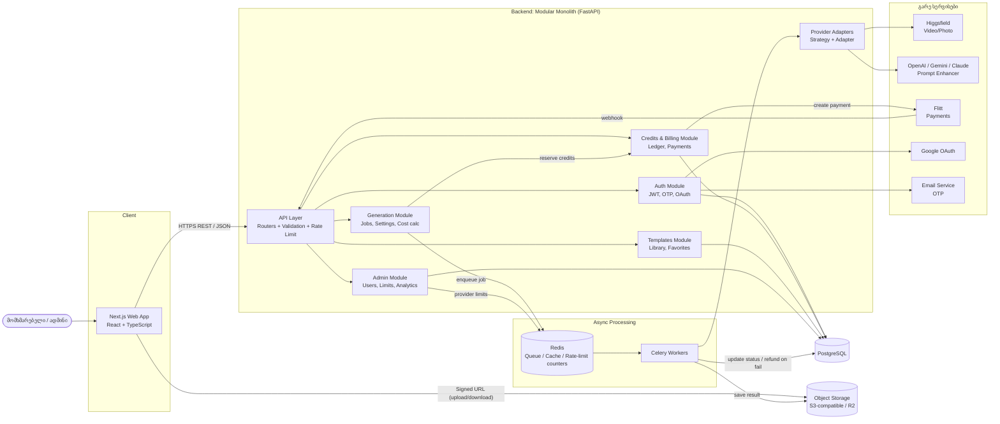
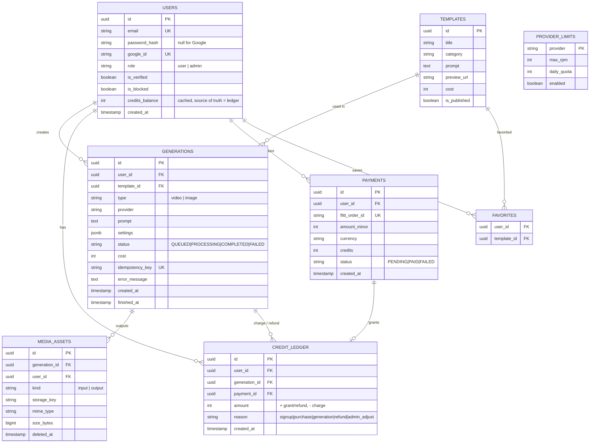

# Product Architecture: Chanafiqri

[← დაბრუნება მთავარ გვერდზე (README.md)](../README.md) · [Product Backlog](./backlog.md)

> **შენიშვნა:** ტექნოლოგიური არჩევანი ემყარება backlog-ში უკვე დაფიქსირებულ გადაწყვეტილებებს (Celery/Redis, Flitt, Google OAuth, Higgsfield/OpenAI/Gemini/Claude, k6, Lighthouse) და NFR-ებს.

---

## 1. არქიტექტურული სტილი

**არჩეული სტილი: Modular Monolith + Asynchronous Job Queue (Event-driven processing)**

ერთი deployable Backend აპლიკაცია, შიგნით მკაფიოდ გამიჯნული მოდულებით (Auth, Generation, Credits/Billing, Templates, Admin). გრძელვადიანი AI გენერაცია გატანილია ცალკე Worker პროცესებში Queue-ს მეშვეობით.

### არგუმენტები

1. **გუნდისა და MVP-ის ზომა.** MVP არის 24 SP (US 1–5). Microservices-ის შემთხვევაში დაგვჭირდებოდა service discovery, ცალკე CI/CD თითო სერვისზე, distributed tracing, რაც მცირე გუნდისთვის ზედმეტი ხარჯია. Monolith-ი = ერთი repo, ერთი deploy, მარტივი debugging.
2. **კრედიტების სიზუსტე (NFR-05: ცდომილება 0%).** კრედიტების ჩამოჭრა, დაბრუნება (refund) და გადახდით შევსება ერთ PostgreSQL ტრანზაქციაში უნდა მოხდეს. ერთ ბაზაზე მდგარი monolith-ი იძლევა ACID გარანტიას. Microservices-ში იგივე მოითხოვდა Saga/distributed transaction-ს, რაც ზუსტად იმ ადგილას ზრდის რისკს, სადაც ცდომილება დაუშვებელია.
3. **გრძელი ამოცანები არ უნდა ბლოკავდეს API-ს (NFR-02, NFR-03).** AI ვიდეოს გენერაცია წამებიდან წუთებამდე გრძელდება. ამიტომ API მხოლოდ ქმნის Job-ს და პასუხობს 2 წამში, ხოლო მძიმე სამუშაოს Celery Worker-ები ასრულებენ. Worker-ები ჰორიზონტალურად იზრდება API-სგან დამოუკიდებლად, ანუ სკალირების მთავარი უპირატესობა microservices-ის გარეშეც გვაქვს.
4. **ევოლუციის გზა.** მოდულები ურთიერთობენ მხოლოდ საჯარო service ინტერფეისებით, ამიტომ მომავალში (მაგ. Generation/Provider მოდულის) ცალკე სერვისად გამოყოფა შესაძლებელია გადაწერის გარეშე.

**განხილული და უარყოფილი:** Microservices (ზედმეტი სირთულე MVP-ისთვის), Serverless (გრძელი ამოცანები და queue-ის მართვა რთულდება, vendor lock-in).

---

## 2. კომპონენტების დიაგრამა



### გენერაციის ძირითადი ნაკადი

```mermaid
sequenceDiagram
  participant U as User (Next.js)
  participant A as API
  participant D as PostgreSQL
  participant Q as Redis Queue
  participant W as Celery Worker
  participant P as AI Provider
  participant S as Object Storage

  U->>A: POST /generations (Idempotency-Key)
  A->>D: BEGIN; lock user row; ledger -cost; insert job(QUEUED); COMMIT
  A->>Q: enqueue(job_id)
  A-->>U: 202 Accepted {job_id}
  Q->>W: job_id
  W->>P: generate(params)
  alt წარმატება
    P-->>W: result URL
    W->>S: copy result to own storage
    W->>D: job = COMPLETED, media_asset saved
  else შეცდომა / timeout
    W->>D: job = FAILED; ledger +cost (refund)
  end
  loop ყოველ 3 წამში
    U->>A: GET /generations/{id}
    A-->>U: status / result_url
  end
```

---

## 3. Design Pattern-ები

### Backend

| Pattern | სად გამოიყენება | რატომ |
|---|---|---|
| **Strategy + Adapter** | `AIProvider` ინტერფეისი (`generate_video`, `generate_image`, `enhance_prompt`). თითო პროვაიდერისთვის ცალკე Adapter: `HiggsfieldAdapter`, `OpenAIAdapter`, `GeminiAdapter`, `ClaudeAdapter` | პროვაიდერის შეცვლა/დამატება ბიზნეს ლოგიკის შეცვლის გარეშე; ადმინის throttling-ისა და fallback-ის მარტივი რეალიზაცია |
| **Repository** | `UserRepository`, `GenerationRepository`, `LedgerRepository` | ბიზნეს ლოგიკა არ არის დაკავშირებული SQL-თან, ტესტირებისას მარტივად იცვლება mock-ით |
| **Service Layer + Unit of Work** | `CreditService.reserve()`, `refund()`; ერთი ტრანზაქცია = ერთი Unit of Work | კრედიტების ჩამოჭრა და Job-ის შექმნა ატომურია (NFR-05) |
| **State Machine** | Generation სტატუსები: `QUEUED → PROCESSING → COMPLETED / FAILED` | დაუშვებელი გადასვლების აკრძალვა (მაგ. `FAILED → COMPLETED`), უსაფრთხო retry |
| **Idempotency Key** | `POST /generations`, Flitt webhook | ორმაგი დაჭერის ან webhook-ის განმეორების დროს ორჯერ არ ჩამოიჭრება/ჩაირიცხება კრედიტი |

### Frontend

| Pattern | სად გამოიყენება | რატომ |
|---|---|---|
| **Custom Hooks + Server State (TanStack Query)** | `useGeneration(id)` (polling), `useCredits()`, `useTemplates()` | API-ის ლოგიკა გამოყოფილია UI-გან, caching და polling მზა მექანიზმით |
| **Container / Presentational Components** | `GenerationPage` (data) და `SettingsPanel`, `ResultCard` (UI) | კომპონენტების ხელახალი გამოყენება და მარტივი ტესტირება |
| **Observer (Polling → SSE)** | Job-ის სტატუსის თვალყურის დევნება | MVP-ში polling, შემდეგ ეტაპზე SSE-ზე გადასვლა კომპონენტების შეცვლის გარეშე |
| **Context Provider** | `AuthProvider` (user, token, credits) | გლობალური მდგომარეობა Prop Drilling-ის გარეშე |
| **Compound Components** | გენერაციის პარამეტრების პანელი (Aspect Ratio, Resolution, Duration, Quality) | ერთიანი პანელი, ცალკეული დამოუკიდებელი კონტროლებით |

---

## 4. API (REST, 5 ძირითადი Endpoint)

Base URL: `/api/v1` · ავტორიზაცია: `Authorization: Bearer <JWT>` (გარდა `/auth/*` და webhook-ისა)

| # | Method + Path | დანიშნულება | Request (მოკლედ) | Response |
|---|---|---|---|---|
| 1 | `POST /auth/register` | რეგისტრაცია და OTP-ის გაგზავნა (US-01) | `{ email, password }` | `201 { message: "OTP sent" }` · `422` ვალიდაციის შეცდომა |
| 2 | `POST /generations` | გენერაციის დაწყება, კრედიტის დაჯავშნა, Job-ის რიგში ჩაყენება (US-02, US-05, US-03) | Header: `Idempotency-Key`. Body: `{ type: "video"\|"image", prompt, template_id?, source_asset_id?, settings: { aspect_ratio, resolution, duration, fps, quality } }` | `202 { id, status: "QUEUED", cost }` · `402` კრედიტი არ ყოფნის · `429` ლიმიტი |
| 3 | `GET /generations/{id}` | Job-ის სტატუსი და შედეგი | - | `200 { id, status, progress?, result_url?, error? }` · `404` |
| 4 | `GET /templates?category=&page=` | შაბლონების ბიბლიოთეკა (US-03) | Query params | `200 { items: [{ id, title, preview_url, cost }], next_page }` |
| 5 | `POST /webhooks/flitt` | გადახდის დადასტურება და კრედიტების ჩარიცხვა (US-06) | Flitt-ის callback + ხელმოწერა | `200` · `400` ხელმოწერა არასწორია. იდემპოტენტურია `order_id`-ით |

**დამატებითი Endpoint-ები (სკოუპის მიღმა):** `POST /auth/verify-otp`, `POST /auth/login`, `GET /me`, `GET /library`, `DELETE /library/{id}`, `POST /prompts/enhance`, `/admin/users`, `/admin/api-limits`, `/admin/templates`.

**ერთიანი შეცდომის ფორმატი:** `{ "error": { "code": "INSUFFICIENT_CREDITS", "message": "..." } }`

---

## 5. ბაზა: SQL (PostgreSQL)

### რატომ SQL

- კრედიტები და გადახდები მოითხოვს **ACID ტრანზაქციებს** და ფინანსურ სიზუსტეს (NFR-05).
- მონაცემები მკაფიოდ რელაციურია (user → generations → assets, user → ledger).
- ცვალებადი გენერაციის პარამეტრებისთვის გამოვიყენებთ `JSONB` სვეტს, ანუ NoSQL-ის მოქნილობაც გვაქვს.
- **Redis** გამოიყენება მხოლოდ queue-სთვის, OTP-ისა და rate-limit მრიცხველებისთვის (დროებითი მონაცემები).

### სქემა



**პრინციპები:**
- `credit_ledger` არის **append-only** (არ იცვლება, მხოლოდ ემატება). ბალანსი = ჩანაწერების ჯამი, `users.credits_balance` კი სწრაფი კეშია, რომელიც ერთსა და იმავე ტრანზაქციაში ახლდება.
- ჩამოჭრისას გამოიყენება `SELECT ... FOR UPDATE` მომხმარებლის ჩანაწერზე, რათა ორმა პარალელურმა მოთხოვნამ ბალანსი არ გადააჭარბოს.
- `UNIQUE(idempotency_key)` და `UNIQUE(flitt_order_id)` იცავს დუბლირებისგან.
- ინდექსები: `generations(user_id, created_at DESC)`, `generations(status)`, `credit_ledger(user_id, created_at)`.
- მედია ფაილები ინახება Object Storage-ში, ბაზაში მხოლოდ `storage_key` არის.

---

## 6. ტექნოლოგიური სტეკი

| ფენა | ტექნოლოგია | კომენტარი |
|---|---|---|
| Frontend | **Next.js (React) + TypeScript + Tailwind CSS** | SSR/SEO და Lighthouse ≥ 90 (NFR-01), TanStack Query |
| Backend | **Python + FastAPI** | async, ავტომატური OpenAPI დოკუმენტაცია, Pydantic ვალიდაცია |
| Async | **Celery + Redis** | NFR-02-ში უკვე მითითებული |
| Database | **PostgreSQL** (SQLAlchemy + Alembic migrations) | ACID, JSONB |
| Storage | **S3-compatible (Cloudflare R2 / AWS S3)** + Signed URLs | გენერირებული მედიის ხანგრძლივი შენახვა |
| Auth | JWT (access + refresh), bcrypt, Google OAuth 2.0 | NFR-05 |
| Payments | **Flitt** | webhook + signature verification |
| AI | Higgsfield (ვიდეო/ფოტო), OpenAI / Gemini / Claude (Prompt Enhancer) | Adapter-ებით |
| DevOps | Docker, GitHub Actions (CI), env secrets | DoD: PR review + CI |
| Testing/Monitoring | k6 (load), Postman/Newman (API), Lighthouse, UptimeRobot, Sentry | NFR-01…04 |

---

## რისკები და შემცირების გზები

| # | რისკი | ალბათობა / გავლენა | შემცირება |
|---|---|---|---|
| 1 | **AI პროვაიდერზე დამოკიდებულება:** ფასის ზრდა, rate limit, მომსახურების გათიშვა ან მოდელის API-ის ცვლილება პირდაპირ აჩერებს პროდუქტის ძირითად ფუნქციას და ზრდის ხარჯს | მაღალი / მაღალი | Adapter + Strategy (პროვაიდერის სწრაფი გადართვა/fallback), `PROVIDER_LIMITS` + Redis-ზე დაფუძნებული throttling, თითო მომხმარებლის დღიური ლიმიტი, ხარჯების მონიტორინგი |
| 2 | **კრედიტებისა და გადახდების არასწორი აღრიცხვა:** ორმაგი ჩამოჭრა, დაკარგული refund, განმეორებული webhook | საშუალო / მაღალი | Append-only ledger, `FOR UPDATE` ლოკი, Idempotency Key, webhook-ის ხელმოწერის შემოწმება, ავტომატური refund `FAILED` Job-ზე, ყოველდღიური reconciliation ტესტი |
| 3 | **Face Swap-ის ბოროტად გამოყენება და კონფიდენციალურობა:** deepfake, არასათანადო კონტენტი, სახის ფოტოების შენახვა პერსონალური მონაცემია. ასევე პროვაიდერის მიერ შედეგის დაბლოკვა მოდერაციის გამო | საშუალო / მაღალი | Terms of Use და თანხმობის checkbox, Prompt/Image მოდერაცია გაგზავნამდე (პროვაიდერის ან LLM-ის moderation API), მომხმარებლის დაბლოკვა ადმინიდან, ატვირთული სახის ფოტოების TTL (ავტომატური წაშლა) |
